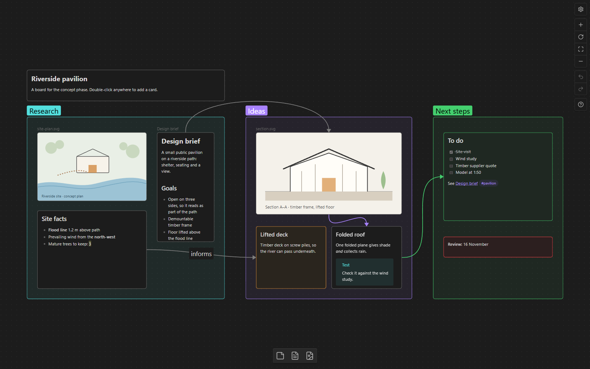

# JSON Canvas for Orca

View and edit Obsidian-compatible `.canvas` boards inside Orca. Requires Orca 1.4.246 or later.



## Install

Find **JSON Canvas** by **MolanoJF** in Orca's community plugin marketplace, install it, and
approve its trusted worker. Open a `.canvas` file and choose the **Canvas** view beside **Source**.

The worker runs with your user account's access to the machine. It reads workspace information
and its own settings, resolves local images and notes, and can write Markdown notes you edit
inline. There is no telemetry. See **How it works** below for vault selection.

This is an independent project, not affiliated with or endorsed by Obsidian.

Opens Obsidian `.canvas` (JSON Canvas) files in an Orca editor tab that looks, navigates and edits
like Obsidian's canvas. Files are saved in Obsidian's own format (tab-indented, one card per line,
same key order), to keep diffs small when moving between editors.

**Saving:** edits mark the Orca tab as modified; press **Ctrl+S** to write the file (Orca does not
let plugins save on their own). The raw JSON stays available in Orca's **Source** tab.

## Editing (as in Obsidian)

| Action | Input |
| --- | --- |
| Add a card | Double-click the canvas, or click/drag a button in the bottom toolbar (card, note, media) |
| Edit a card | Double-click it, Enter, or the pencil in the selection menu |
| Select | Click; Shift+click to add; drag on the canvas for a selection box; Ctrl+A |
| Move | Drag (groups carry the cards inside them); Arrow keys nudge (Shift = 5 steps) |
| Duplicate | Alt+drag, or right-click → Duplicate |
| Resize | Drag any edge or corner (Shift+corner keeps the ratio) |
| Connect | Hover a card's edge, drag from its dot to another card; drop on empty canvas to add a connected card |
| Reconnect an edge | Select it, drag one of its ends |
| Edit a label | Double-click a group label or an edge |
| Color, group, align, line direction, background | Selection menu above the selection |
| Delete | Delete / Backspace |
| Copy, cut, paste | Ctrl+C / Ctrl+X / Ctrl+V (pasted text or URLs become cards) |
| Undo / redo | Ctrl+Z / Ctrl+Shift+Z, or the buttons on the right |
| Read-only | Gear → Read-only; the lock turns editing back on |
| Snapping | Gear → Snap to grid / Snap to objects (guides show while dragging) |

The card editor is CodeMirror with Obsidian-style live preview: markdown marks hide except on the
line you are on, `[[` suggests notes from the vault, Ctrl+B / Ctrl+I toggle bold and italic, lists
continue on Enter. Double-clicking a note card edits the note itself; that writes the `.md` file
directly, and refuses if the note changed on disk meanwhile.

## Viewing

Text cards render Obsidian-flavoured Markdown (wikilinks, embeds, highlights, tags, callouts, tasks,
tables, comments). File cards show images, video, audio and notes (or one `#heading`/`#^block`);
PDFs and other files are placeholders that open in Orca. Link cards open the URL in the browser,
because Orca frames have no network. The camera, grid, label scaling, edge curves and zoomed-out
placeholders follow Obsidian.

Navigation: scroll pans, Shift+scroll pans sideways, Ctrl+scroll / Space+scroll / pinch zooms,
Space+drag or middle-drag pans, Shift+1 zoom to fit, Shift+2 zoom to selection.

## Differences from Obsidian

- No autosave: press Ctrl+S.
- While editing a card, tables, images and callouts show as Markdown source (inline syntax is
  live-previewed).
- No web page previews in link cards, no PDF rendering, no tag search, no "Convert to file",
  no drag-and-drop of files from outside.

## How it works

The editor frame is sandboxed (no file system, no network) and only receives the canvas text. A
small worker (`worker/main.js`, Node) finds the vault (the Orca workspace holding the canvas, or
the folder above it with `.obsidian`), resolves paths and links the way Obsidian does, streams files
to the frame in chunks, lists vault files for the pickers, and writes notes edited inline. It only
touches files inside a known vault. If a vault is not an Orca workspace, add its folder under
Settings → Plugins → JSON Canvas → *Extra vault folders*.

## Development

Loaded as a development plugin: `orca plugin dev load <this folder>`. Code edits reload on save.
Frame errors appear in `orca plugin logs local.json-canvas`. `marked` and CodeMirror 6 (MIT)
are vendored in `editor/vendor/`. Icon paths come from Lucide (ISC); third-party notices ship
alongside the code.

To preview the included demo without installing the plugin:

```powershell
$env:VAULT = (Resolve-Path dev/demo).Path
$env:ORCA_CLI = (Get-Command orca).Source
node dev/harness.mjs dev/demo/demo.canvas 5179
```

Open `http://127.0.0.1:5179/editor/index.html?theme=dark` (or `theme=light`). The harness
keeps canvas edits in memory, stubs note writes, and does not open real Orca tabs.

To rebuild CodeMirror, run `npm ci` in `build/codemirror`, then:

```text
npx esbuild entry.js --bundle --format=esm --minify --outfile=../../editor/vendor/codemirror.js
```

Validate before releasing with `orca plugin validate . --json`. Releases are version tags
matching `orca-plugin.json`; the `orca-plugin` repository topic enables marketplace discovery.
